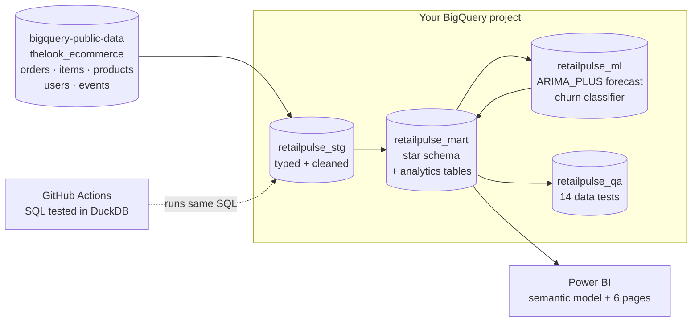

# RetailPulse: End-to-End E-commerce Analytics (BigQuery · SQL · Power BI)

A complete analytics build on **real public data in BigQuery**
(`bigquery-public-data.thelook_ecommerce`): a layered SQL warehouse, cohort,
RFM, funnel and product analytics, BigQuery ML forecasting and churn scoring,
automated data tests, and a 6-page Power BI report.


<!-- add your screenshots after building the report -->

## Architecture



| Layer | Tables |
|---|---|
| Staging | `users`, `products`, `orders`, `order_items`, `events`, `distribution_centers` |
| Star schema | `dim_date`, `dim_product`, `dim_customer`, `fct_order_items`, `fct_orders`, `fct_sessions` |
| Analytics | `agg_daily_kpis` (rolling avg, YoY), `agg_cohort_retention`, `customer_rfm`, `agg_funnel`, `agg_product_performance` (Pareto/ABC), `agg_category_affinity` (market basket lift), `agg_fulfillment` |
| ML | `revenue_forecast` (ARIMA_PLUS, 90 days), `churn_model` (logistic regression) → `agg_revenue_forecast`, `customer_churn_scores` |
| QA | `test_results`: uniqueness, not-null, referential integrity, accepted values, freshness, revenue reconciliation |

**SQL techniques used:** CTEs, window functions (`ROW_NUMBER`, `NTILE`, `LAG`, rolling `AVG`, running `SUM`), `QUALIFY`-style dedupe, `ANY_VALUE … HAVING MIN`, `LOGICAL_OR` session flags, self-join market basket, `APPROX_QUANTILES`, `GENERATE_DATE_ARRAY`, partitioning + clustering, BigQuery ML (`CREATE MODEL`, `ML.FORECAST`, `ML.PREDICT`, `ML.EVALUATE`, `ML.GLOBAL_EXPLAIN`).

## Run it

### Option A: Local test (no Google account, 1 minute)
```bash
pip install -r requirements.txt
python tests/test_local.py
```
Runs every SQL file in DuckDB against a small fixture with the same schema and checks all data tests.

### Option B: BigQuery (free sandbox works)
1. Go to console.cloud.google.com → create a project → open **BigQuery**. The sandbox needs no credit card.
2. Install the [gcloud CLI](https://cloud.google.com/sdk/docs/install), then:
```bash
gcloud auth application-default login
python scripts/run_pipeline.py --project YOUR_PROJECT_ID              # builds everything + runs tests
python scripts/run_pipeline.py --project YOUR_PROJECT_ID --with-ml    # + BigQuery ML
```
- Datasets are created in the **US** multi-region (the public dataset lives there).
- Sandbox: tables expire after 60 days. Just re-run the script. Don't use `--partition` in the sandbox, since partitions older than 60 days would be dropped.
- Cost: a full run reads a few GB, well inside the free 1 TB/month query tier. Check first with `--dry-run`.

### Option C: Power BI
Follow [`powerbi/POWERBI_BUILD_GUIDE.md`](powerbi/POWERBI_BUILD_GUIDE.md). Measures are in `powerbi/measures.dax`, and the theme is in `powerbi/retailpulse_theme.json`.

## Findings
Run `analysis/insights.sql` and write up 4–6 findings with a recommendation each in `docs/findings.md`.

## Repo layout
```
sql/01_staging      typed, cleaned source tables
sql/02_marts        star schema
sql/03_analytics    KPIs, cohorts, RFM, funnel, products, basket, fulfillment
sql/04_ml           BigQuery ML forecast + churn
sql/05_tests        data tests
scripts/            BigQuery runner
tests/              DuckDB local test + schema-identical fixture
analysis/           headline insight queries
powerbi/            DAX measures, theme, build guide
docs/               metric definitions, findings, how to pitch, screenshots
```

*Data: Google's public `thelook_ecommerce` dataset is a fictitious clothing retailer, generated by Google's Looker team.*
